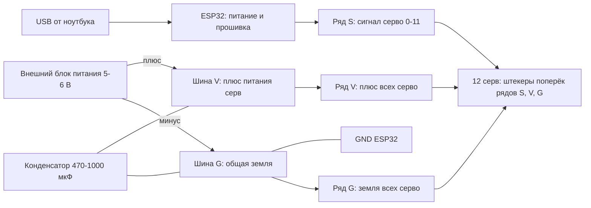

# Harnet

Робот-паук на ESP32 (4 ноги, 12 серв). Модернизация проекта
[arkadiy-core](https://github.com/VxDxK/arkadiy-core): перенос с Arduino на ESP32.
Полное описание задач - в [docs/technicalTask.md](docs/technicalTask.md).

# Перенос на ESP32 и плата-адаптер

План-конспект по аппаратной части. Этап 1 (база): ESP32 + 12 серв.
Этап 2 (позже): датчики, измерение батареи, питание от батареек.

---

## 1. Задача и принцип решения

**Задача.** Заменить Arduino Nano на ESP32 так, чтобы:

- провода серв не разбирать и не перепаивать;
- сервы оставались совместимыми со старой платой;
- микроконтроллер можно было менять.

**Решение.** Между сервами и ESP32 ставится отдельная плата-адаптер на перфорированной плате:

- ESP32 вставляется в женские гребёнки и не припаивается намертво;
- штекеры серв втыкаются в ряды контактов S / V / G;
- плата сама соединяет пины ESP32 с сигнальными контактами серв и объединяет питание и землю.

Менять микроконтроллер = вынуть одну плату из гнёзд и вставить другую с тем же расположением пинов. Сервы при этом не трогаются.

---

## 2. Что известно о железе

| Параметр | Значение |
|---|---|
| Плата | ESP32 DevKit, модуль **ESP32-WROOM-32**, 30 пинов (2 ряда по 15), шаг 2,54 мм |
| Штыри на ESP32 | **не припаяны**, нужно припаять |
| Расстояние между рядами пинов | **r** (не измерено, не критично, см. раздел 6.1) |
| Сервы | модель неизвестна (маркировку надо уточнить), рабочее напряжение 5-6 В |
| Измеренный ток всех серв | в среднем 0,12-0,17 А, мощность около 0,7 Вт |
| Расчётный запас по току | ориентир около 1 А (пики короткие, дисплей блока питания их не показывает) |
| Питание серв сейчас | лабораторный блок питания, около 5-6 В |
| Питание ESP32 на этапе 1 | только USB |

---

## 3. Как управляется серво (основы)

У серво три провода:

| Провод | Цвет | Назначение |
|---|---|---|
| Сигнал (PWM) | жёлтый или оранжевый | команда «повернись на угол», у каждой серво свой пин |
| Питание (V+) | красный | +5-6 В, по нему идёт ток мотора |
| Земля (GND) | чёрный или коричневый | возврат тока и точка отсчёта сигнала |

Угол задаётся длиной импульса в цикле 20 мс (50 Гц): около 0,5-1 мс это 0°, около 1,5 мс это 90°, около 2-2,5 мс это 180°.

**Порядок контактов в штекере: сигнал, плюс, земля. Плюс всегда в середине.**

---

## 4. Что в коде зависит от платы

Код (`VxDxK/arkadiy-core`) состоит из трёх слоёв:

| Слой | Файлы | Зависит от платы? |
|---|---|---|
| ArkadiyCore (движения) | `spider.cpp`, `spider.h` | нет, обращается к `servos[0..11]` |
| ServoWrapper (границы углов) | `servo_wrap.cpp`, `servo_wrap.h` | только через библиотеку `Servo.h` |
| Запуск | `arkadiy_core.ino` | массив `ports[]` |

**При смене платы меняются только два места:**

1. массив `ports[]`;
2. библиотека `Servo.h` на `ESP32Servo.h` в `servo_wrap.h` и `servo_wrap.cpp`.

Логика движений и калибровка углов не меняются.

### Структура ног

Сервы идут тройками (4 ноги по 3 сустава):

| Нога | Серво |
|---|---|
| 1 | 0, 1, 2 |
| 2 | 3, 4, 5 |
| 3 | 6, 7, 8 |
| 4 | 9, 10, 11 |

Какая тройка какой физической ноге соответствует, неизвестно. Для адаптера это не важно: он опирается на номера серво, а не на названия ног.

---

## 5. Электрика адаптера

### 5.1 Две независимые цепи

- **Силовая цепь**: питание моторов серв, около 5-6 В, большие токи. Источник: внешний блок питания.
- **Логическая цепь**: ESP32 и её сигналы, 3,3 В, миллиамперы. Источник: USB.

Цепи не смешиваются, но имеют общую землю.

### 5.2 Почему сервы нельзя питать от ESP32 или USB

Проблема не в напряжении (5 В подходит), а в **токе**. USB-порт даёт 0,5 А (USB 2.0) или 0,9 А (USB 3.0), а ESP32 сама потребляет 0,1-0,3 А. Если взять ток серв оттуда, напряжение просядет, ESP32 перезагрузится (brownout), а ноутбук может отключить порт.

### 5.3 Общая земля

Серво воспринимает сигнал относительно **своего** провода земли. Если земля ESP32 и земля питания серв не соединены, у них нет общей точки отсчёта, и серво не слушается или дёргается.

Должно быть соединено в одну точку: GND блока питания, шина G серв и пин GND ESP32. Пин GND ESP32 лучше присоединить к шине **в месте входа питания** (рядом с клеммником), а не на дальнем конце шины.

### 5.4 Конденсатор

Электролитический, 470-1000 мкФ, не менее 10 В. Ставится между шинами V и G рядом с клеммником. Сглаживает кратковременные просадки, когда несколько серв одновременно трогаются.

**У конденсатора есть полярность:** полоса на корпусе обозначает минус. Минус на шину G, плюс (длинная ножка) на шину V. При неверном включении он нагреется и может взорваться.

### 5.5 Сигнальные линии

12 независимых проводов: пин ESP32 к контакту в ряду S. Токи микроамперные, провод может быть тонким. ESP32 выдаёт 3,3 В, большинство серв SG90/MG90 это воспринимает. Если часть серв будет вести себя странно, это первое, что стоит проверить (решение: преобразователь уровня).

---

## 6. Физическая сборка адаптера

### 6.1 Детали (этап 1)

| Деталь | Кол-во | Назначение |
|---|---|---|
| Перфоплата, шаг 2,54 мм, рекомендую 9×15 см | 1 | основа с запасом места под этап 2 |
| Штыри (мужские гребёнки) 15 контактов | 2 | припаиваются **к ESP32** |
| Женские гребёнки 15 контактов | 2 | гнёзда для ESP32, припаиваются к перфоплате |
| Мужские гребёнки для рядов S, V, G | 3 ряда по 12 (с пропусками, см. 6.2) | места подключения серв |
| Клеммник на 2 контакта | 1 | вход внешнего питания |
| Электролитический конденсатор 470-1000 мкФ, не менее 10 В | 1 | сглаживание питания |
| Провода: тонкие для сигналов, потолще для шин V и G | по необходимости | соединения |
| Мультиметр | 1 | проверка перед включением |

**Как обойтись без измерения расстояния r.** Припаяйте штыри к ESP32. Вставьте на них обе женские гребёнки (ESP32 сверху, гребёнки снизу). Эту сборку целиком поставьте на перфоплату и припаяйте гребёнки к ней, пока ESP32 в них вставлена. Расстояние выйдет правильным само. Паять быстро, 2-3 секунды на контакт.

### 6.2 Зона серв: три ряда

Три параллельных ряда контактов, штекер серво втыкается поперёк всех трёх:

- **ряд S** (сигнал): каждый из 12 контактов соединён своим проводом с пином ESP32;
- **ряд V** (плюс), средний: все 12 контактов соединены между собой, идут на плюс клеммника;
- **ряд G** (земля): все 12 контактов соединены между собой, идут на минус клеммника и на GND ESP32.

Ряд V всегда в середине, потому что так расположены контакты в штекере.

Между тройками серв оставить **пустой столбец**: штекеры не мешают друг другу, и нога видна по раскладке.

**Подписать на плате крупно:** какая сторона S, а какая G, и номера серво 0-11. Цвета: жёлтый или оранжевый провод на сторону S, чёрный или коричневый на сторону G. У многих штекеров нет ключа, поэтому подпись заменяет защиту от неправильной вставки. Если вставить задом наперёд, плюс останется на месте, а сигнал и земля поменяются, и ESP32 может повредить пин.

### 6.3 Размещение

- **USB-разъём ESP32 должен выступать за край платы**, чтобы можно было воткнуть кабель для прошивки.
- Клеммник и конденсатор у края платы, рядом с началом шин V и G.
- Свободное место справа от ESP32 и ниже под второй этап (датчики, резисторы, схема питания).

```
                         край платы
 ┌──────────────────────────────────────────────────────┐
 │                                                      │
 │ ▓▓USB▓▓  ┌── гнёзда ряд A (15 контактов) ──┐   (резерв │
 │  ESP32   │                                  │   этап 2)│
 │ выступает└── гнёзда ряд B (15 контактов) ──┘           │
 │  за край                                             │
 │                                                      │
 │   нога 1       нога 2       нога 3       нога 4      │
 │   0  1  2  ·   3  4  5  ·   6  7  8  ·   9 10 11     │
 │ S  •  •  •     •  •  •      •  •  •      •  •  •  ← сигнал (каждый на свой пин)
 │ V  •  •  •     •  •  •      •  •  •      •  •  •  ← плюс (общая шина)
 │ G  •  •  •     •  •  •      •  •  •      •  •  •  ← земля (общая шина)
 │                                                      │
 │ [клеммник +/-]  (конденсатор)                        │
 └──────────────────────────────────────────────────────┘
```

---

## 7. Таблица распиновки серв (зафиксирована)

Номер серво (индекс в `servos[]`) остаётся прежним, меняется только пин. Старые пины взяты из `ports = {9, 10, 12, 8, 11, 13, 7, 5, 3, 6, 4, 2}`.

| Серво | Нога | Пин Nano (старый) | GPIO ESP32 (новый) | Подпись на плате ESP32 |
|---|---|---|---|---|
| 0 | 1 | D9 | 13 | D13 |
| 1 | 1 | D10 | 14 | D14 |
| 2 | 1 | D12 | 16 | RX2 |
| 3 | 2 | D8 | 17 | TX2 |
| 4 | 2 | D11 | 18 | D18 |
| 5 | 2 | D13 | 19 | D19 |
| 6 | 3 | D7 | 23 | D23 |
| 7 | 3 | D5 | 25 | D25 |
| 8 | 3 | D3 | 26 | D26 |
| 9 | 4 | D6 | 27 | D27 |
| 10 | 4 | D4 | 4 | D4 |
| 11 | 4 | D2 | 5 | D5 |

Новый массив для кода:

```cpp
int ports[SERVO_COUNT] = { 13, 14, 16, 17, 18, 19, 23, 25, 26, 27, 4, 5 };
```

**Важно по соответствию штекеров.** Штекер серво с номером N должен попасть в позицию N на адаптере. Если подписи на проводах серв утеряны, соответствие можно восстановить двумя способами: по фото старой проводки (какой жёлтый провод в какой пин Nano, переводится по таблице выше) или тестовой программой, которая по очереди двигает серво 0, 1, 2... и показывает, какой сустав шевелится. Ошибка при подключении не требует перепайки: достаточно поменять числа в `ports[]`.

**Нюанс.** Пины 5 и 14 при включении ESP32 выдают короткий импульс, поэтому серво 11 и серво 1 могут слегка дёрнуться при подаче питания. Это не поломка.

---

## 8. Какие пины ESP32 нельзя использовать для серв

| Пины | Причина |
|---|---|
| GPIO 6-11 | заняты флеш-памятью модуля (на вашей плате не выведены) |
| GPIO 34, 35, 36, 39 (подписи D34, D35, VP, VN) | только входы |
| GPIO 1 и 3 (подписи TX0, RX0) | канал прошивки через USB |
| GPIO 0, 2, 12, 15 (подписи D2, D12, D15) | strapping-пины: от их состояния при включении зависит загрузка |

### Зарезервированные пины (на этапе 1 не занимать)

| Пины | Для чего оставить |
|---|---|
| D32, D33 | TRIG ультразвуковых датчиков (выходы) |
| D34, D35 | ECHO ультразвуковых датчиков (входы, через делитель) |
| VP (GPIO36) | измерение напряжения батареи |
| VN (GPIO39) | датчик звука (необязательный) |
| D21, D22 | шина I2C (датчики, дисплеи) |

Аналоговые входы блока ADC1 (GPIO 32-39) работают при включённом Wi-Fi, а блока ADC2 нет. Поэтому датчики оставлены именно на ADC1.

---

## 9. Электрическая схема (этап 1)



Сигнальные линии: серво 0 → GPIO13, 1 → GPIO14, 2 → GPIO16, 3 → GPIO17, 4 → GPIO18, 5 → GPIO19, 6 → GPIO23, 7 → GPIO25, 8 → GPIO26, 9 → GPIO27, 10 → GPIO4, 11 → GPIO5.

### Правила питания

- Внешний блок питания подключён **только к клеммнику** адаптера и питает **только сервы**.
- ESP32 питается от USB.
- Не подавать питание серв на 3V3 или VIN ESP32.
- Не подключать 5 В на VIN одновременно с USB.

---

## 10. Порядок работ и проверки (этап 1)

1. Припаять штыри к ESP32 (2 ряда по 15).
2. Собрать «бутерброд» из ESP32 и женских гребёнок, поставить на перфоплату, припаять гребёнки.
3. Припаять три ряда контактов для серв (S, V, G) с пустыми столбцами между тройками.
4. Припаять клеммник и конденсатор (проверить полярность).
5. Соединить контакты ряда V между собой, затем ряд G между собой. Подключить ряд V к плюсу клеммника, ряд G к минусу.
6. Припаять 12 сигнальных проводов от гнёзд ESP32 к ряду S по таблице раздела 7.
7. Соединить шину G с гнездом GND ESP32.
8. **Проверка мультиметром в режиме прозвонки, без ESP32 и без серв:**
   - нет замыкания между шиной V и шиной G;
   - нет замыкания между соседними сигнальными линиями;
   - нет замыкания между сигнальными линиями и шинами;
   - каждая сигнальная линия действительно идёт к нужному гнезду ESP32.
9. Подать внешнее питание 5 В без ESP32 и без серв, измерить напряжение на рядах V и G.
10. Вставить ESP32, подключить **одну** серво, убедиться, что она слушается.
11. Подключать остальные сервы по одной.
12. Запустить код с `ESP32Servo` и новой таблицей `ports[]`.

---

## 11. Что менять в коде (позже)

- В `servo_wrap.h` и `servo_wrap.cpp`: `#include "Servo.h"` заменить на `#include <ESP32Servo.h>`. Библиотеку установить в Arduino IDE.
- В `arkadiy_core.ino`: новый массив `ports[]` из раздела 7.
- Углы калибровки в `attach(...)` и весь класс `Spider` не менять.

### Замечания к исходному коду (пока только зафиксировать)

1. В `ServoWrap::write` условие `if (percent > 100 && percent < 0)` никогда не выполняется (нужно «или»), защиты от значений вне 0-100 нет.
2. `Spider::safeTimeWrite` ждёт, пока `read()` покажет нужное значение, но `Servo::read()` возвращает последний заданный угол, а не реальное положение. Ожидание завершается сразу.
3. Команда `go` вызывает `safeTimeStepForward()`; функция `stepForward()` нигде не вызывается.

---

## 12. Этап 2 (из ТЗ, после проверки базы)

Добавляется после того, как этап 1 собран и работает.

### 12.1 Ультразвуковые датчики HC-SR04, 2 шт.

- TRIG1 → D32, TRIG2 → D33 (выходы).
- ECHO1 → D34, ECHO2 → D35 (входы).
- Питание датчиков 5 В и земля берутся с шин V и G адаптера.
- Сигнал ECHO у датчика 5 В, а входы ESP32 выдерживают 3,3 В. На каждую линию ECHO нужен делитель из двух резисторов: ECHO → резистор 1 кОм → пин ESP32, и от пина ESP32 → резистор 2 кОм → GND. Получается 5 В × 2 / (1 + 2) ≈ 3,3 В.

### 12.2 Измерение напряжения батареи

VP (GPIO36) через делитель напряжения (номиналы подобрать под максимальное напряжение батарейного блока: на пине не должно быть больше 3,3 В).

### 12.3 Датчик звука (необязательный)

VN (GPIO39).

### 12.4 Питание от батареек

- Серво: 4,8-6 В. Подходит блок из 4 элементов AA. NiMH лучше отдают пики тока, чем щелочные.
- **Больше 6 В на сервы нельзя.** Литиевые сборки 7,4 В (2S) только через понижающий преобразователь.
- **Риск для ESP32:** линейный стабилизатор на плате требует на входе примерно 4,5-5 В и выше. Четыре NiMH дают около 4,8 В, под нагрузкой серв напряжение просядет, ESP32 может перезагрузиться и оборвать Wi-Fi (ТЗ, NFR-2). Решение нужно выбрать до пайки второго этапа: отдельный источник для ESP32, фильтр или повышающий преобразователь.
- ТЗ требует пик тока не менее 3 А «с уточнением после определения модели серв». По измерению среднее потребление 0,12-0,17 А, цифру в ТЗ можно уменьшить, оставив запас на пики.

### 12.5 Что заложить на плате заранее

- Свободное место (примерно треть платы) под датчики, резисторы и схему питания.
- Отдельные контакты рядом с гнёздами ESP32 для зарезервированных пинов (раздел 8).
- Место на шинах V и G для подключения питания датчиков.

---

## 13. Типичные ошибки и последствия

| Ошибка | Последствие |
|---|---|
| Земля ESP32 не соединена с шиной G | сервы не слушаются или дёргаются |
| Питание серв с пина ESP32 или от USB | перезагрузки ESP32, возможно отключение USB-порта |
| Переполюсовка блока питания | можно сжечь сервы и ESP32 |
| Замыкание V и G на плате | срабатывание защиты блока питания, перегрев |
| Штекер серво вставлен наоборот | сигнал и земля поменялись, возможен выход из строя пина ESP32 |
| Конденсатор включён наоборот | нагрев, возможен взрыв |
| 5 В с шины на VIN при подключённом USB | токи между источниками, возможен вред порту компьютера |
| Паять ESP32 долго | перегрев; паять 2-3 секунды на контакт |

---

## 14. Открытые вопросы

- [ ] Маркировка серв (SG90, MG90S, другая) и их допустимое напряжение.
- [ ] Расстояние между рядами пинов r (не нужно при сборке «бутербродом»).
- [ ] Соответствие подписей на проводах серв номерам серво 0-11 (восстановить по фото или тестовой программой).
- [ ] Схема питания ESP32 от батареек (этап 2).
- [ ] Модель HC-SR04 или вариант с логикой 3,3 В (этап 2).

---

## 15. Источники

- `VxDxK/arkadiy-core`: `arkadiy_core.ino`, `servo_wrap.h/.cpp`, `spider.h/.cpp`.
- `lo2545/Harnet/docs/technicalTask.md` (ТЗ). Остальное содержимое репозитория Harnet не использовалось.
- Презентация проекта «Павук Аркадий» (`piikt-pauk.pdf`).
- Фото платы ESP32 (подписи пинов).
